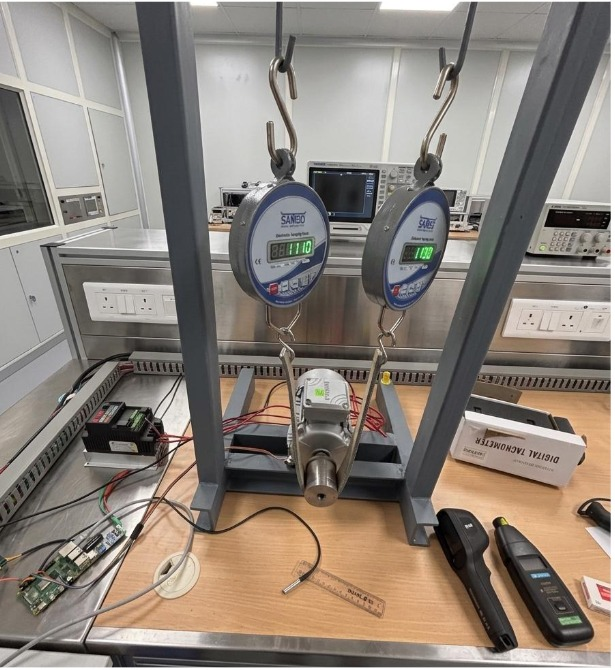
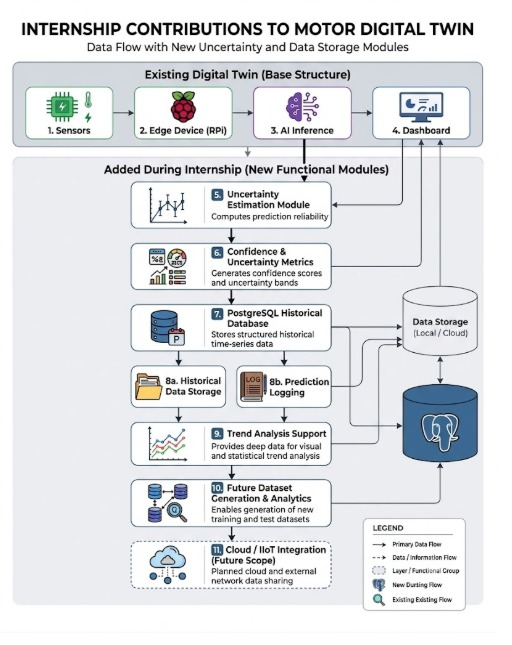
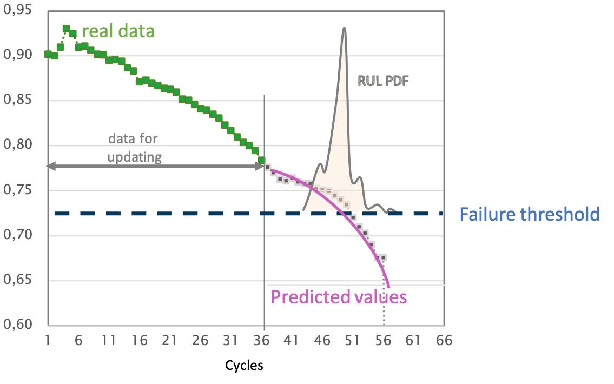
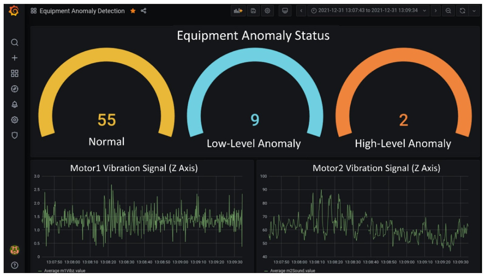

# CSIR-NPL Digital Twin: Telemetry Persistence & Uncertainty Extension

A focused extension for an AI-enabled industrial induction-motor Digital Twin inference service. This repository contains the supplied FastAPI inference server and an additive PostgreSQL persistence and measurement-uncertainty layer.
<p align="center">
  
</p>
## Scope

The extension is designed to:
- Record telemetry and inference outputs in PostgreSQL for historical analysis and dataset generation.
- Track Type A and Type B measurement uncertainty and calculate combined/expanded uncertainty.
- Keep database writes in a FastAPI background task so a slow database write does not delay the prediction response.
- Degrade gracefully when PostgreSQL is unavailable: inference can continue while dataset logging is disabled.

## Project Architecture
<p align="center">
  
</p>

## Repository contents

- `inference_server.py` — supplied FastAPI inference server with the persistence and uncertainty integration.
- `storage/` — PostgreSQL configuration, connection management, schema, models and repository.
- `uncertainty/` — Type A, Type B and combined uncertainty calculations.
- `sql/001_create_inference_cycles.sql` — optional manual schema migration.
- `.env.example` — environment-variable template; contains placeholders only.
- `requirements-additions.txt` — additional dependencies for this extension.
- `README_EXTENSION.md` — detailed implementation notes, design decisions and verification procedure.

## RUL Prediction
<p align="center">
  
</p>

## Important scope and verification notes

This repository is an extension, not a complete export of the original Digital Twin system.

The supplied implementation notes state that:
- The edge controller and inference service were not fully wired together in the supplied codebase.
- The inference server is the component that performs predictions in the supplied implementation.
- Model artifacts (`dt_model_artifacts/*.onnx` and `meta_learner.pkl`) were not included in the supplied files.
- Full end-to-end inference and PostgreSQL integration therefore still require validation in the intended environment.
- Some schema fields are reserved for future metrics and remain unpopulated by the current implementation.

Do not describe the system as fully deployed, fully integrated, or production-validated unless you have subsequently verified those claims.

## Setup

1. Use the Python environment and existing dependencies required by the original inference server.
2. Install this extension's additional dependencies:

   ```bash
   pip install -r requirements-additions.txt
   ```

3. Copy `.env.example` to `.env` and configure a PostgreSQL database. Never commit `.env`.
4. Place the required model artifacts in the expected `dt_model_artifacts/` directory.
5. Start the service using the command appropriate to your existing deployment. The exact command and model paths should be confirmed against your environment.

The application attempts to initialize the PostgreSQL schema at startup. If PostgreSQL is unavailable, the implementation notes state that inference should remain available with dataset logging disabled.

## Attribution and contribution

This repository documents a technical extension involving telemetry persistence and uncertainty estimation. The portfolio description should distinguish the work personally designed or implemented from work performed by the wider project team, project lead, mentors or AI-assisted development.

## Status
Prototype / extension. End-to-end validation with the original model artifacts and a live PostgreSQL instance remains to be completed unless separately verified.
<p align="center">
  
</p>
